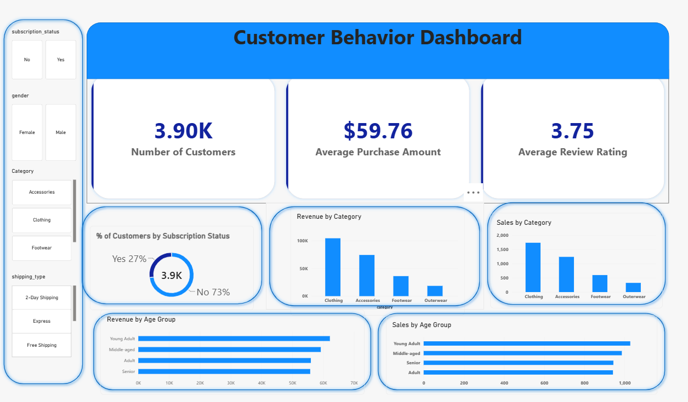

# Customer Shopping Behavior Analysis

## 📌 Overview

This project focuses on analyzing customer shopping behavior to identify purchasing patterns, customer preferences, spending trends, and subscription behavior.

The project follows an end-to-end data analytics workflow using **Python, MySQL, and Power BI**. It involves data exploration, data cleaning, feature engineering, SQL-based business analysis, and interactive dashboard development to generate meaningful business insights.

The objective is to transform raw customer shopping data into actionable insights that can help businesses better understand their customers and make data-driven decisions.

## 📊 Dataset

- **Dataset:** Customer Shopping Behavior
- **Total Records:** 3,900
- **Original Columns:** 18
- **Format:** CSV

The dataset contains customer shopping information, including:

- Customer demographics (age, gender, location)
- Purchase details (item, category, purchase amount)
- Product preferences (size, color, season)
- Customer reviews and ratings
- Subscription status and discount usage
- Shipping and payment methods
- Previous purchases and purchase frequency

## 🛠️ Tools & Technologies

| Tool | Purpose |
|---|---|
| Python | Data analysis and preprocessing |
| Pandas | Data manipulation and cleaning |
| NumPy | Numerical operations |
| Matplotlib / Seaborn | Data visualization |
| Jupyter Notebook | Exploratory data analysis |
| MySQL | SQL queries and business analysis |
| SQLAlchemy | Database connection |
| PyMySQL | Python–MySQL connectivity |
| Power BI | Interactive dashboard development |

## 🔍 Project Steps

### 1. Data Loading & Exploration (Python)

- Imported the dataset using Pandas.
- Explored the dataset using `head()`, `info()`, and `describe()`.
- Examined column names, data types, and missing values.
- Identified data quality issues before analysis.

### 2. Data Cleaning & Feature Engineering

- Handled missing values in the Review Rating column using category-wise median imputation.
- Standardized column names by converting them to lowercase and replacing spaces with underscores.
- Renamed the purchase amount column for easier analysis.
- Created age groups using quartile-based segmentation with `pd.qcut()`.
- Converted purchase frequency categories into numerical day intervals.
- Removed the redundant Promo Code Used column after checking its consistency with Discount Applied.

### 3. SQL Analysis (MySQL)

Loaded the cleaned dataset into MySQL using SQLAlchemy and PyMySQL.

Performed business analysis using SQL queries, including:

- Analyzing total revenue generated by male and female customers.
- Identifying customers who used discounts but spent above the average purchase amount.
- Finding the top-rated products based on average review ratings.
- Comparing average purchase amounts across shipping methods.
- Evaluating spending and revenue differences between subscribers and non-subscribers.
- Identifying products with the highest number of discounted purchases.
- Segmenting customers into New, Returning, and Loyal groups.
- Finding the top three most purchased products within each category using window functions.
- Analyzing subscription behavior among repeat buyers.
- Evaluating revenue contribution across different age groups.

**SQL concepts used:**
- SELECT, WHERE, GROUP BY, ORDER BY
- Aggregate functions (SUM, AVG, COUNT)
- Subqueries
- Common Table Expressions (CTEs)
- CASE statements
- Window functions (ROW_NUMBER)

### 4. Power BI Dashboard

Developed an interactive Power BI dashboard to visualize customer shopping behavior and business performance.

The dashboard includes:

- **Key Performance Indicators:** Total customers, average purchase amount, and average review rating.
- **Category Analysis:** Revenue and customer distribution across product categories.
- **Subscription Analysis:** Distribution of subscribed and non-subscribed customers.
- **Age Group Analysis:** Customer distribution and revenue contribution across age groups.
- **Interactive Filters:** Gender, category, shipping type, and subscription status.

## 📈 Dashboard

The Power BI dashboard provides an interactive overview of customer purchasing patterns, product category performance, and customer demographics.

**Dashboard Preview:**

<!-- Add a screenshot of your Power BI dashboard here -->
<!-- Example:  -->

To explore the complete dashboard, open the `.pbix` file using Microsoft Power BI Desktop.

## 💡 Key Results & Insights

The analysis of 3,900 customer records revealed the following:

- **Total Revenue:** $233,081 generated across all purchases.
- **Average Purchase Amount:** Approximately $59.76.
- **Average Review Rating:** Approximately 3.75 out of 5.
- **Category Performance:** Clothing generated the highest revenue ($104,264), followed by Accessories ($74,200).
- **Gender-Based Revenue:** Male customers contributed $157,890, while female customers contributed $75,191.
- **Subscription Behavior:** 1,053 customers had active subscriptions, compared to 2,847 non-subscribers.

These findings provide a descriptive overview of customer purchasing behavior, revenue distribution, and subscription patterns.

## ⚙️ How to Run

### Prerequisites

Make sure you have installed:

- Python 3.x
- Jupyter Notebook
- MySQL Server
- MySQL Workbench (optional)
- Microsoft Power BI Desktop

### Step 1: Clone the Repository

```bash
git clone https://github.com/your-username/customer-behavior-analysis.git
cd customer-behavior-analysis
```

### Step 2: Install Required Python Libraries

```bash
pip install pandas numpy matplotlib seaborn sqlalchemy pymysql jupyter
```

### Step 3: Run the Python Notebook

Open Jupyter Notebook:

```bash
jupyter notebook
```

Open `customer_behaviour_Analysis.ipynb` and execute the cells to load, explore, clean, and preprocess the dataset.

### Step 4: Configure MySQL Connection

Create a MySQL database named `mydatabase`.

Update the database connection details in the notebook:

```python
from sqlalchemy import create_engine

username = "root"
password = "your_password"
host = "localhost"
port = "3306"
database = "mydatabase"

engine = create_engine(
    f"mysql+pymysql://{username}:{password}@{host}:{port}/{database}"
)
```

Execute the notebook's database-loading section to import the cleaned DataFrame into the `mytable` table.

### Step 5: Execute SQL Queries

- Open MySQL Workbench.
- Connect to your MySQL database.
- Select the `mydatabase` database.
- Open `Customer_behaviour_sql_quries.sql`.
- Execute the queries to perform business analysis.

### Step 6: Open the Power BI Dashboard

- Open `Customer Behavior Dashboard.pbix` using Power BI Desktop.
- Configure the MySQL data connection if prompted.
- Refresh the data if required.
- Explore the dashboard using the available interactive filters.

## 📁 Project Structure

```text
Customer-Behavior-Analysis/
│
├── customer_shopping_behavior.csv
│
├── customer_behaviour_Analysis.ipynb
│
├── Customer_behaviour_sql_quries.sql
│
├── Customer Behavior Dashboard.pbix
│
├── images/
│   └── dashboard.png
│
└── README.md
```

## 🎯 Conclusion

This project demonstrates an end-to-end data analytics workflow, starting from raw dataset exploration and preprocessing to SQL-based business analysis and interactive Power BI visualization.

It provided practical experience in Python data analysis, data cleaning, feature engineering, relational database connectivity, SQL querying, and dashboard development.

The project highlights how data analytics tools can be combined to extract meaningful customer insights and support data-driven business decisions.

---
